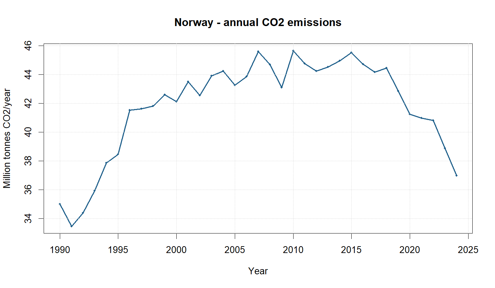
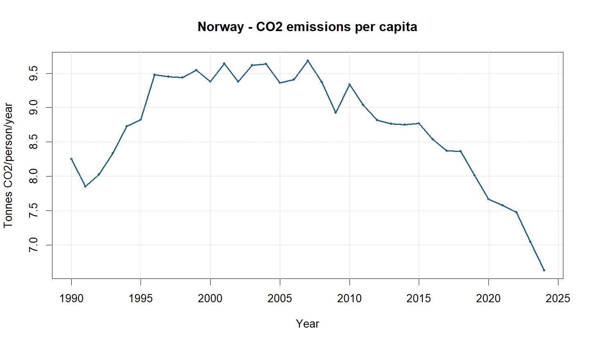
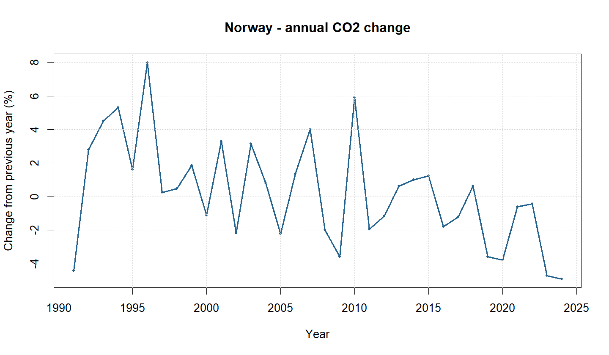

# CO2 emissions analysis: Norway

*Student:* Mishelle Ann Jabel  
*Country / ISO-3:* Norway / NOR  
*Study period:* 1990 to 2024  
*Declared to instructor on:* November 13, 2026

## Research question

How have annual CO2 emissions and per-capita emissions changed in Norway from 1990 to 2024?

## Data source and definitions

This analysis uses the Our World in Data (OWID) CO2 and Greenhouse Gas Emissions dataset.

Dataset: https://github.com/owid/co2-data

Downloaded on: November 13, 2026.

The selected variables were year, co2, and co2_per_capita. The variable co2 represents annual CO2 emissions from fossil fuels and industrial processes in million tonnes per year, excluding land-use change. The variable co2_per_capita represents tonnes of CO2 emitted per person per year.

## How to reproduce the analysis

1. Install R, RStudio, and Git.
2. Open this repository as an RStudio Project.
3. Make sure an internet connection is available for the first download of the OWID dataset.
4. In the RStudio Console, run:

source("scripts/analyze_co2.R")

5. Inspect the generated files in the data/, figures/, and results/ folders.

## Results

- Earliest valid year: 1990.
- Latest valid year: 2024.
- Annual CO2 emissions in 1990: 34.99 million tonnes.
- Annual CO2 emissions in 2024: 36.97 million tonnes.
- Percentage change from 1990 to 2024: +5.64%.
- Peak emissions year: 2010.
- Peak annual emissions: 45.64 million tonnes.
- Latest available CO2 per-capita value: 6.63 tonnes per person.

## Interpretation

Norway's CO2 emissions changed considerably between 1990 and 2024. Annual emissions were 34.99 million tonnes in 1990 and 36.97 million tonnes in 2024, giving an overall increase of about 5.64%. However, this endpoint comparison does not show the full pattern. Emissions generally increased during the 1990s and 2000s and reached a peak of 45.64 million tonnes in 2010. After periods of fluctuation, the annual-emissions graph shows a clear decline during the later part of the study period.

The per-capita pattern also shows an important difference from total emissions. Total emissions measure the amount released by the country as a whole, while per-capita emissions relate those emissions to population size. By 2024, Norway's per-capita emissions had fallen to 6.63 tonnes per person. The sustained decline visible during the later years is therefore apparent in both national and per-person emissions. The year-to-year graph also shows that annual changes were not constant, with both increases and decreases occurring throughout the study period.

One possible context for the more recent decline is Norway's transition toward lower-emission transport. The Norwegian government reports that taxation and incentives have encouraged electric vehicle adoption, with electric vehicles accounting for 88% of new passenger-car sales in 2024. This may have contributed to lower transport emissions, although this analysis does not prove that EV policies caused the national trend.

National CO2 patterns matter ecologically because carbon emissions contribute to climate change, which can affect ecosystems, species distributions, and environmental conditions. However, territorial emissions data have limitations because they measure emissions produced within national borders and do not fully represent emissions associated with imported goods and consumption.

## Limitations

This analysis uses territorial CO2 emissions, so emissions associated with imported goods are not fully represented. The OWID co2 variable used here excludes land-use change and therefore does not represent all greenhouse gas emissions. Country-level values can also hide differences among economic sectors and regions within Norway. Finally, observed trends alone cannot establish the causes of changes in emissions.

## References

- Our World in Data. CO2 and Greenhouse Gas Emissions dataset. https://github.com/owid/co2-data
- Norwegian Ministry of Transport. Norway is electric. https://www.regjeringen.no/en/topics/transport-and-communications/veg/faktaartikler-vei-og-ts/norway-is-electric/id2677481/